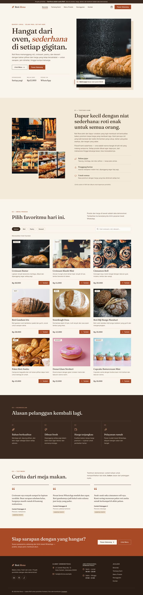
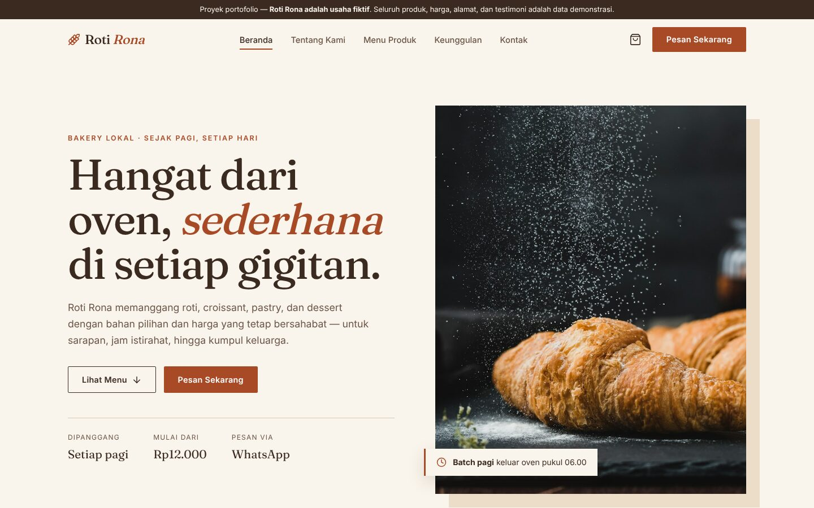
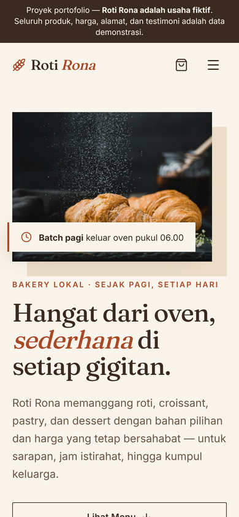
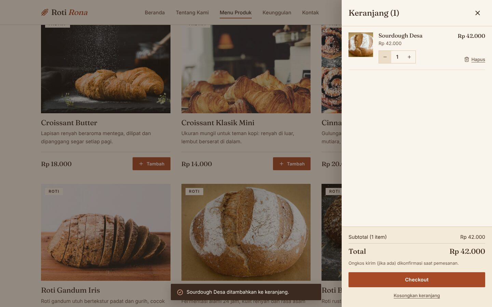
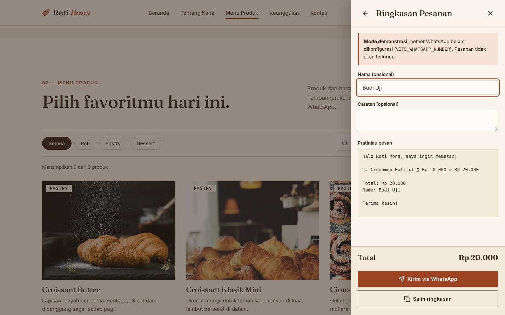

# Roti Rona — Landing Page UMKM (Proyek Portofolio)

Landing page interaktif untuk **Roti Rona**, usaha roti & pastry lokal **fiktif**. Dibuat sebagai *self-initiated portfolio project* frontend — bukan website klien sungguhan. **Seluruh produk, harga, alamat, jam operasional, kontak, dan testimoni adalah data demonstrasi** dan ditandai fiktif di dalam website.



| Hero | Mobile | Keranjang | Checkout |
|---|---|---|---|
|  |  |  |  |

## Tujuan proyek
Menunjukkan kemampuan membangun landing page UMKM yang profesional: desain editorial yang hangat, komponen React terstruktur, fitur e-commerce ringan (katalog → keranjang → pesanan WhatsApp) tanpa backend, serta aksesibilitas dan responsivitas.

## Permasalahan yang ingin diselesaikan
UMKM kuliner sering hanya mengandalkan media sosial untuk menampilkan menu dan menerima pesanan, sehingga katalog sulit dijelajah dan pesanan dicatat manual. Website ini menampilkan menu yang bisa dicari/difilter dan menyusun pesanan otomatis menjadi pesan WhatsApp yang rapi.

## Target pengguna
Mahasiswa, pekerja, keluarga, dan masyarakat umum yang mencari roti berkualitas dengan harga terjangkau.

## Teknologi
React 19 · TypeScript · Vite · CSS modern (custom properties, tanpa framework) · Lucide Icons · Fontsource (Fraunces & Inter, self-hosted) · Vitest.

## Fitur unggulan
- Navbar sticky responsif (menu hamburger di mobile), sorotan section aktif, scroll halus ke setiap section.
- Katalog 9 produk dengan **filter kategori**, **pencarian**, dan *empty state*.
- **Keranjang**: tambah, ubah jumlah, hapus, subtotal & total otomatis, buka/tutup (drawer), tersimpan di `localStorage`.
- **Checkout** menyusun ringkasan pesanan (nama & catatan opsional, pratinjau pesan, salin ringkasan).
- **Integrasi WhatsApp** via variabel lingkungan; **mode demonstrasi** dengan notifikasi bila nomor belum diisi.
- Aksesibilitas dasar: semantic HTML, skip link, label ARIA, fokus terjebak & dikembalikan pada dialog, Escape menutup dialog, `prefers-reduced-motion`.
- SEO dasar: title, meta description, Open Graph, `lang="id"`.

## Instalasi & menjalankan
Prasyarat: Node.js 20+.

```bash
npm install
cp .env.example .env   # opsional, lihat bagian konfigurasi
npm run dev            # http://localhost:5173
```

Perintah lain:

```bash
npm run build      # typecheck + production build ke dist/
npm run preview    # pratinjau hasil build
npm test           # unit test (logika keranjang & pesan WhatsApp)
```

## Konfigurasi WhatsApp
Isi `VITE_WHATSAPP_NUMBER` di file `.env` (format internasional, hanya angka, contoh pola `62XXXXXXXXXXX`). Jika kosong/tidak valid, tombol *Kirim via WhatsApp* tidak mengirim apa pun dan menampilkan notifikasi bahwa fitur masih mode demonstrasi. File `.env` di-ignore oleh Git; **jangan commit nomor/kredensial**. Karena variabel `VITE_*` ditanam ke bundle saat build, nomor akan terlihat publik di website produksi (wajar untuk nomor pemesanan).

## Struktur folder
```
public/images/     foto produk & etalase (lokal)
src/
  components/      Navbar, Hero, About, Catalog, ProductCard, WhyUs, Testimonials, CtaSection, Footer, CartDrawer, ...
  context/         CartContext (state keranjang), ToastContext (notifikasi)
  data/            products, testimonials, site (data demonstrasi)
  hooks/           useActiveSection, useDialog
  lib/             cart (reducer & perhitungan), whatsapp, format + unit test
  styles/          base.css, sections.css, cart.css
scripts/e2e.cjs    skrip uji browser Playwright (opsional)
docs/screenshots/  tangkapan layar
```

## Pengujian
- `npm test`: 7 unit test (reducer keranjang, perhitungan total, normalisasi nomor, penyusunan pesan/URL WhatsApp).
- `scripts/e2e.cjs`: uji browser end-to-end (navigasi, filter, pencarian, keranjang, checkout, mode demo vs. WhatsApp terkonfigurasi, overflow mobile/tablet, error console). Jalankan dua dev server (port 5173 tanpa nomor, 5174 dengan `VITE_WHATSAPP_NUMBER` uji) lalu `node scripts/e2e.cjs <folder-screenshot>` dengan Playwright terpasang.

## Batasan & asumsi
- Tidak ada backend: pesanan tidak disimpan di server; pemesanan hanya lewat tautan WhatsApp (`wa.me`).
- Tidak ada pembayaran online, ongkos kirim, atau stok.
- Seluruh data bersifat fiktif; tautan media sosial hanyalah placeholder.
- Foto produk dari [Unsplash](https://unsplash.com) (lisensi Unsplash); beberapa foto adalah representasi umum, bukan foto produk persis dengan namanya.
- Belum ada halaman terpisah/multibahasa; fokus pada satu landing page berbahasa Indonesia.
